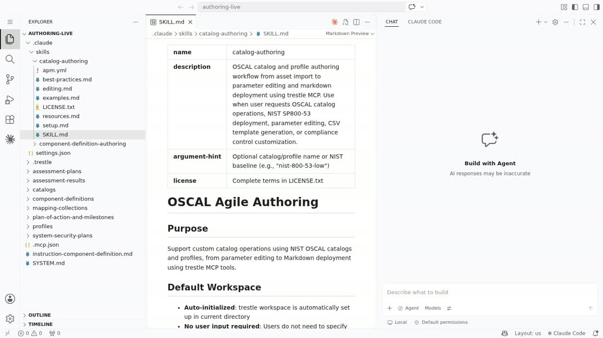
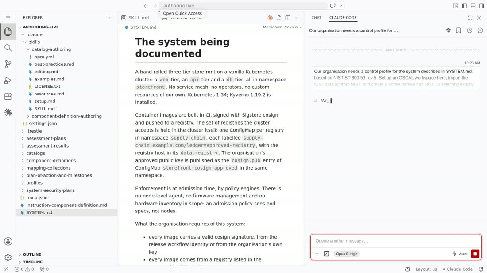
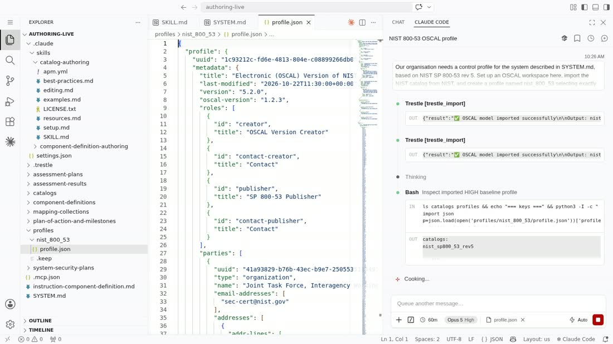
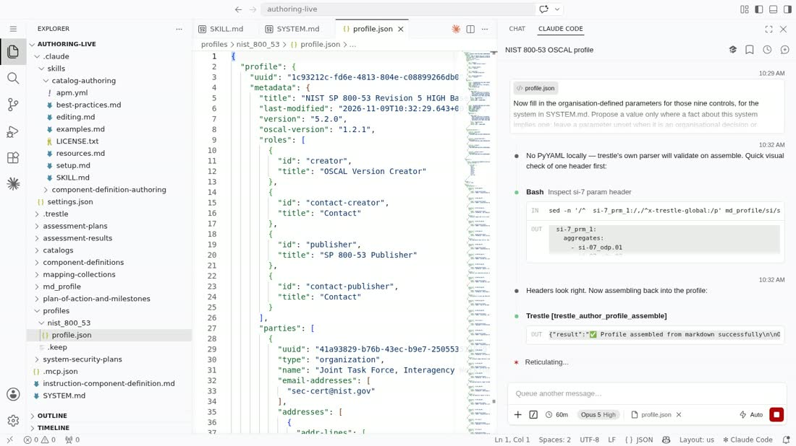
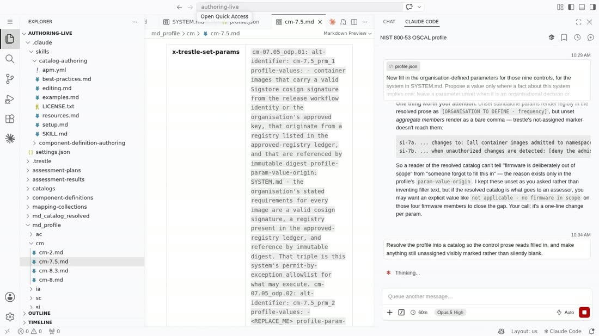
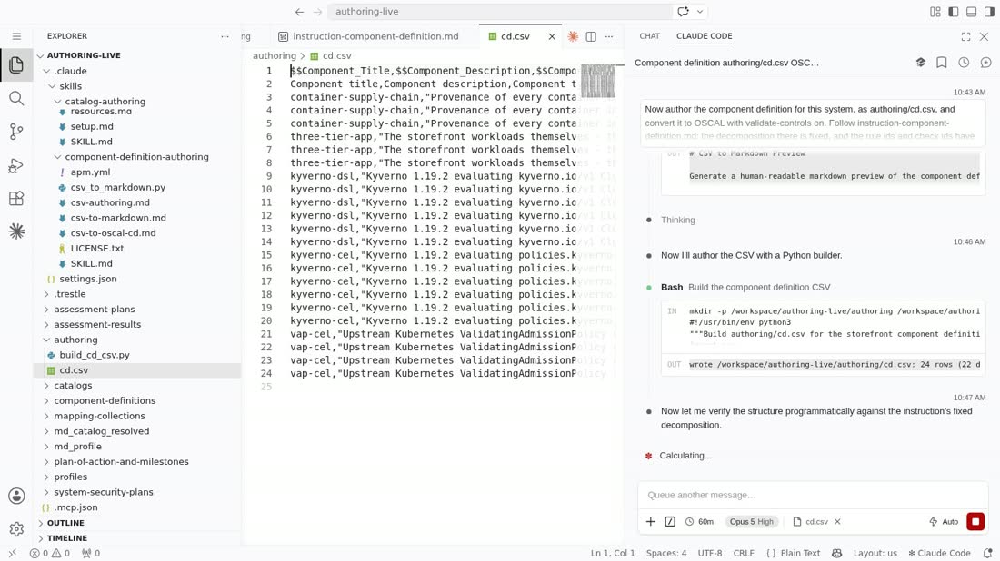
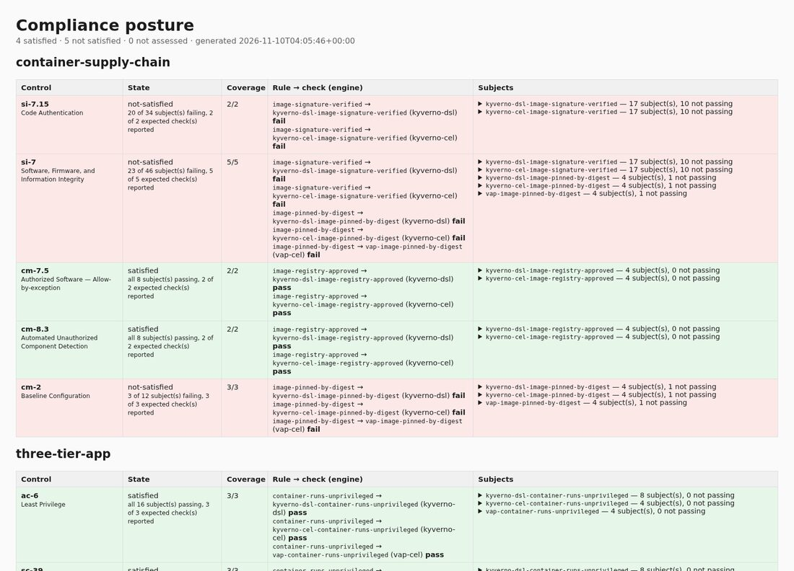
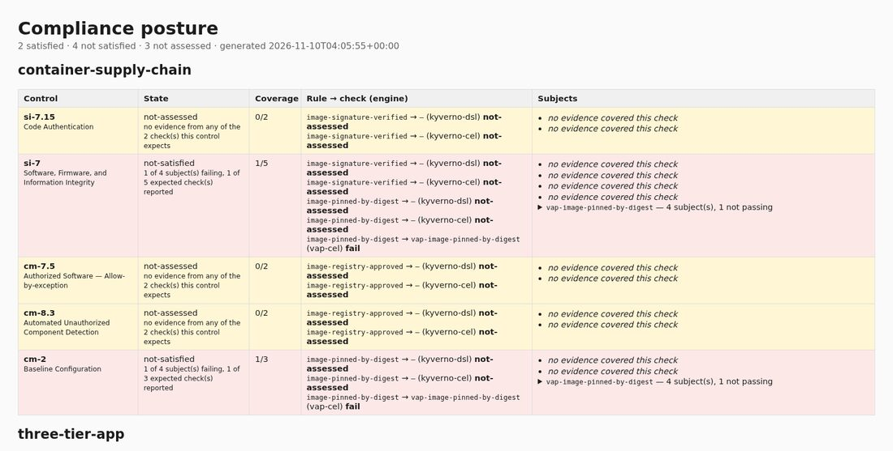

# Walkthrough: from a NIST control to a cluster, and back

This demo is about two components doing an entire compliance lifecycle between them: the
**`agentic-agile-authoring` skills**, which author the OSCAL, and **`compliance-to-policy`**, which
turns it into policy, runs it against a cluster and reports what came back.

A person writes two prose documents and gives five prompts. The `agentic-agile-authoring` skills
produce the profile, the organisation-defined parameter values, the resolved catalog and the
component definition, issuing every trestle operation through the `compliance-trestle-mcp` server —
steps 1 to 6. A fifth prompt goes to `compliance-to-policy`'s own
[`policy-generation`](../../skills/policy-generation/) skill, which writes the policy templates —
step 7, and the step the name **C2P++** is about. `c2p` then takes the component definition and
those templates and does everything after them — steps 8 to 10. No code was written for this demo.

| step | | component |
|---|---|---|
| 1 | install the skills | `compliance-authoring-skills` (`agentic-agile-authoring`) |
| 2 | the two documents a human writes | a human |
| 3 | import the catalog, select nine controls | `catalog-authoring` skill → `compliance-trestle-mcp` |
| 4 | fill the organisation-defined parameters | `catalog-authoring` skill → `compliance-trestle-mcp` |
| 5 | resolve the profile | `catalog-authoring` skill → `compliance-trestle-mcp` |
| 6 | author and convert the component definition | `component-definition-authoring` skill → `compliance-trestle-mcp` |
| 7 | write one policy template per check, per engine | `policy-generation` skill |
| 8 | policy for three engines, read, applied, collected, assessed, posture | `compliance-to-policy` |
| 9 | the same with one engine | `compliance-to-policy` |
| 10 | compare the two postures | `c2p tools posture-compare` |

Steps 3 to 7 are prompts rather than commands. In steps 3 to 6 the skills decide which OSCAL
operations to perform and issue them through the MCP server, so `trestle` runs underneath but is
not the interface; step 7 writes files directly. Steps 8 and 9 need a cluster; every other step is
a function of files committed in this directory, step 10 included.

## What you need

`uv`, which provides the `uvx` that runs the installer and the MCP servers, and runs the commands in
steps 8 to 10.

Steps 8 to 10 run from a checkout of this repository, after installing it once:

```sh
uv venv --python 3.12 && uv pip install -e . && . .venv/bin/activate
export PYTHONPATH=.          # plugins_public is a source tree, not an installed package
```

`--python 3.12` is not optional: compliance-trestle 5.x needs 3.10 or newer, and a system
Python 3.9 fails on `cannot import name 'TypeGuard' from 'typing'`. After this, `python` and
`c2p` are the ones in the virtualenv, which is why the commands below carry no runner prefix.

`capture/*.cmd` holds each command exactly as it was run.

For steps 8 and 9, a cluster with the storefront app on it: the namespaces, the approved-registry
ledger, and the three-tier app **including two workloads that are deliberately non-compliant and
were created before any policy existed**. Standing that up is scaffolding rather than part of this
chain, and the `kubecon-na-2026-demo` repository has a `make up` target that does it. That the
violations pre-date the policy matters for the numbers in step 8: Kyverno's background scan finds
things admission control never had a chance to stop, which is where most real findings live.

The output on this page was captured on 2026-11-10 against Kubernetes 1.34.0 on kind with Kyverno
1.19.2, using compliance-trestle 5.2.0 and OSCAL 1.2.1. Under [`capture/`](capture/) there are three
files per command — `.cmd`, `.out` (stdout and stderr, merged, verbatim) and `.rc`. Where a line
below is shortened for the page, `...` marks the elision.

One thing the numbered list hides: step 8 is three commands with a person between the first and
the second, and they are not all the same kind of thing. C2P generates the policy, as C2P always
has. A person reads it. Only then does anything touch a cluster, and both commands that do — the
deploy and the collector — are a worked example in [`reference/`](reference/) rather than part of
the `c2p` library. See
[`reference/README.md`](reference/README.md) for why, and for what to look for when reading.

---

## 1. Install the skills

The skills do not arrive by hand. `agentic-agile-authoring` ships an installer CLI,
`compliance-authoring-skills`, a thin wrapper over [OpenAPM](https://github.com/microsoft/apm):

```sh
compliance-authoring-skills install \
    --skill catalog-authoring,component-definition-authoring \
    --target claude
```



*Look at the left-hand tree. Both skills are deployed under `.claude/skills/`, `.mcp.json` sits
beside them, and the only other files are the two documents a human wrote — the OSCAL directories
are present but empty. The OSCAL artefacts in this directory were produced by steps 3 to 6, not
shipped with it.*

Selection is `--demo <name>`, `--exclude a,b` or `--skill a,b`; `--project <dir>` chooses where to
install and `--global` switches to user scope.

**It wires the MCP server for you.** APM copies each skill package into the harness's native skills
directory *and* resolves that skill's declared `dependencies.mcp`, merging each server
non-destructively into the harness's own MCP config. `compliance-trestle-mcp` appears in `.mcp.json`
because `catalog-authoring` declares it — not because anyone hand-wrote a config block. A skill
brings its own tools:

```json
{
  "mcpServers": {
    "trestle": {
      "command": "uvx",
      "args": [
        "--from", "git+https://github.com/oscal-compass/compliance-trestle-mcp.git",
        "--with", "mcp<2",
        "trestle-mcp"
      ]
    }
  }
}
```

**The skills are not tied to one harness.** `--target` takes `claude`, `opencode`, `bob` or
`myharness`, and APM writes each one's native layout. The editor in the screenshots is
**code-server** — VS Code in a browser — and the panel on the right of each is the **Claude Code
extension**; that is the harness this run used, not a requirement.

The frames in steps 1 to 6 are from a recorded run of those steps. It is the same procedure that
produced the OSCAL committed here, but a separate run of it, so uuids, timestamps and the component
definition's title differ between a frame and the corresponding file in this directory. Each caption
describes only what is visible in its own frame; every number quoted in the prose comes from the
committed artefacts, which are linked at the step that produces them.

## 2. The two documents a human writes

| file | role |
|---|---|
| [`authoring/SYSTEM.md`](authoring/SYSTEM.md) | the system in prose — a three-tier storefront on vanilla Kubernetes, cosign-signed images, an in-cluster approved-registry ledger, digest pinning, admission-time enforcement, and what the organisation requires of it |
| [`authoring/instruction-component-definition.md`](authoring/instruction-component-definition.md) | the authoring contract — the two service components, the three validation components, the six rules and their control mappings, the `<engine>-<rule-id>` check-id scheme, and why two rules deliberately carry no `vap-cel` check |

`SYSTEM.md` is the only free-text description of the system that enters the chain, and every
parameter value, rule description and control mapping downstream is an answer to something it says.
If a value cannot be traced back to a sentence in it, that is the signal that someone invented a
capability the system does not have.

The five prompts that follow are committed verbatim under [`prompts/`](prompts/).

## 3. A profile over nine controls

> `catalog-authoring` skill.

[`prompts/p1.txt`](prompts/p1.txt):

> Our organisation needs a control profile for the system described in SYSTEM.md, based on NIST SP
> 800-53 rev 5. Set up an OSCAL workspace here, import the NIST catalog from NIST, and create a
> profile named nist_800_53 selecting exactly these nine controls from the HIGH baseline: ac-6 cm-2
> cm-7.5 cm-8 cm-8.3 ia-5 sc-39 si-7 si-7.15. Do not fill in any parameter values yet.



*Look at the panel on the right: what a human supplies is the prompt, in prose. No `trestle` command
is typed here or anywhere else in steps 3 to 6.*

NIST ships SP 800-53 rev 5 as OSCAL, so there is no extraction step and nothing is transcribed. The
skill imports the catalog and writes a profile that selects by `include-controls.with-ids`.



*Look at the tree on the left: `catalogs/` and `profiles/nist_800_53/profile.json`, neither of
which existed a moment earlier, and the panel on the right, where two `trestle_import` calls have
returned. The open file is scrolled to the profile's metadata; the nine ids are further down, in
[`oscal/profiles/nist_800_53/profile.json`](oscal/profiles/nist_800_53/profile.json).*

Out: [`oscal/profiles/nist_800_53/profile.json`](oscal/profiles/nist_800_53/profile.json).

Two things about that list are decisions rather than consequences, and the profile's
`metadata.remarks` records both. **It stands on HIGH, not MODERATE**, because `si-7.15` (Code
Authentication) is HIGH-only and image signature verification is the most interesting rule here. And
**`cm-14` is absent though it is the control you would expect** — CM-14 is Signed Components, the
intuitive mapping for image signing, but it is selected by *no* NIST baseline, so claiming it would
mean claiming a control nobody's baseline asks for. `si-7.15` carries that mapping instead.

`modify.alters` is empty: no control prose is tailored. The only thing this profile does to the
catalog is set parameters, which keeps the authoring auditable.

## 4. The organisation-defined parameters

> `catalog-authoring` skill.

[`prompts/p2.txt`](prompts/p2.txt):

> Now fill in the organisation-defined parameters for those nine controls, for the system in
> SYSTEM.md. Propose a value only where a fact about this system implies one; leave a parameter
> unset when it is an organisational decision or outside this system's scope, and record why in the
> profile itself. Then assemble the values back into the profile.



*Look at the tool call in the right-hand panel: `Trestle [trestle_author_profile_assemble]`,
returning that the profile was assembled successfully. That one frame is the division of labour —
the agent decided what each parameter should say, and trestle, reached through the MCP server,
performed the assembly.*

NIST ships the controls; it does not ship the values. The official rev 5.1.1 HIGH baseline profile
selects 370 controls and its `modify` block is **empty** — zero `set-parameters`. A control is a
sentence with holes in it, and filling those holes for a named system is what authoring means.

The committed profile sets ten, each answering something `SYSTEM.md` states: `si-07.15_odp` becomes
"all container images admitted to the storefront namespace" because the system description says
every image is signed and enforcement is at admission; `si-07_odp.04` becomes "blocking admission of
the affected workload" because that is what an admission policy does when a check fails — there is
no quarantine step to claim.

Every other parameter is **left unset on purpose**, in two categories: *genuinely an organisational
decision*, implied by no system fact — a cadence, a frequency, a role — and *outside this system's
scope*, meaning anything about hardware or firmware, because an admission policy sees pod specs, not
nodes.

The failure mode of this step is not a blank parameter but a value asserting a capability the system
does not have. A resolved control reads as a flat declarative sentence, so an invented value is hard
to detect downstream. `param-value-origin` records where a value came from, next to the value:



*Look at `cm-07.05_odp.01`: an authored sentence, and directly under it `param-value-origin:
SYSTEM.md` — where the value came from, recorded beside the value. (`cm-07.05_odp.02` below it reads
`<REPLACE_ME>`, which is trestle's placeholder in the generated markdown before assembly, not a
value in the finished profile.)*

## 5. Resolve

> `catalog-authoring` skill.

[`prompts/p3.txt`](prompts/p3.txt):

> Resolve the profile into a catalog so the control prose reads filled in, and make anything still
> unassigned visibly marked rather than silently blank.

Out:
[`oscal/catalogs/nist_800_53_resolved/catalog.json`](oscal/catalogs/nist_800_53_resolved/catalog.json),
carrying **17 `UNASSIGNED:` markers** on exactly the parameters step 4 declined to invent —
`UNASSIGNED: frequency`, `UNASSIGNED: personnel`, `UNASSIGNED: firmware` and so on.

An unfilled organisation-defined parameter is a **visible, auditable hole**, and an invented value is
not. A resolved catalog with seventeen marked gaps is a more honest document than one with none.

**With one limitation the run surfaced.** The not-assigned marker reaches *standalone* parameters but
not the *members of an aggregate*. An unset standalone parameter resolves to something a reader
cannot miss — `[ORGANISATION TO DEFINE — frequency]` — while an unset member of an aggregate such as
`si-7_prm_1` resolves to a bare comma in the control sentence. For those, the resolved catalog does
not distinguish *deliberately out of scope* from *someone forgot*, which is precisely the distinction
this step exists to preserve. The `param-value-origin` prop still records the reason in the profile,
so the information is not lost — it just does not survive into the resolved prose.

This catalog is not only for humans: it is what gives the controls in step 8's posture their titles.

## 6. The component definition

> `component-definition-authoring` skill.

[`prompts/p4.txt`](prompts/p4.txt):

> Now author the component definition for this system, as authoring/cd.csv, and convert it to OSCAL
> with validate-controls on. Follow instruction-component-definition.md: the decomposition there is
> fixed, and the rule ids and check ids have to match it exactly.



*Look at the middle pane: `cd.csv`, written by the skill against the fixed decomposition in
`instruction-component-definition.md`.*

The decomposition is fixed rather than discovered, because the policy templates were generated
against it, so rule ids and check ids must match exactly. That makes authoring the CSV a
transcription task with the judgement in the *descriptions*.


*Left to right: the two skills in the tree, the generated
`component-definition.json` in the middle, and on the right the MCP tool call that produced it —
`Trestle [trestle_task_csv_to_oscal_cd]`, returning `CSV converted to OSCAL component definition`,
followed by "Conversion succeeded — the `validate_controls` gate ran (resolved controls: `[ac-6,
cm-2, cm-7.5, cm-8, cm-8.3, ia-5, sc-39, si-7, si-7.15]`)". The gate names the nine controls it
checked the rules against.*

Out: [`authoring/cd.csv`](authoring/cd.csv) — 6 service rows and 16 validation rows, 6 rules over the
9 controls — and
[`oscal/component-definitions/kubecon-storefront/component-definition.json`](oscal/component-definitions/kubecon-storefront/component-definition.json):

| component | type | declares |
|---|---|---|
| `container-supply-chain` | service | 3 rules, 3 set-parameters, 5 implemented requirements (`si-7.15` `si-7` `cm-7.5` `cm-8.3` `cm-2`) |
| `three-tier-app` | service | 3 rules, 2 set-parameters, 4 implemented requirements (`ac-6` `sc-39` `cm-8` `ia-5`) |
| `kyverno-dsl` | validation | 6 checks |
| `kyverno-cel` | validation | 6 checks |
| `vap-cel` | validation | 4 checks |

A validation component is an engine, and the checks it declares are the checks that engine owns.

`vap-cel` declares four checks, not six. Two rules have no ValidatingAdmissionPolicy check, which is
authored rather than missing, and each says so in its own `Rule_Description`:

> "Enforced by Kyverno only: an upstream ValidatingAdmissionPolicy evaluates CEL inside the API
> server and can neither fetch the signature from the registry nor make the transparency-log round
> trip that cosign verification requires, so this rule deliberately carries no vap-cel check."

`validate-controls on` rejects a rule citing a control the profile does not select, which is what
stops `cm-14` from reappearing here.

What passes from this step to step 7 is the control decision, not the policy.

## 7. One policy template per check — the step C2P++ names

Steps 3 to 6 decided *which* control a rule satisfies and *which* check verifies it. None of them
said what the check does on a cluster. That is the template's job, and it is the one artefact in
this chain that cannot be computed from anything upstream: a component definition that says
"container images must be pinned by digest" does not contain the CEL that decides it, and no
amount of reading the OSCAL will produce
`variables.containers.filter(c, !c.image.contains('@sha256:'))`.

Writing it needs knowledge of the engine rather than of C2P — which `apiVersion` the cluster will
accept, that the CEL available to ValidatingAdmissionPolicy has no `flatten()`, that a Kyverno
`verifyImages` rule is a mutating webhook. So a fifth skill does it. This step is what **C2P++**
names, and the only thing it names: everything after it is C2P doing what C2P has always done.

[`prompts/p5.txt`](prompts/p5.txt):

> Generate the vap-cel policy templates for this component definition, one per check vap-cel
> declares. Follow template-contract.md for the render context, and if the engine cannot express a
> check, do not write that check.

Run against a workspace holding step 6's component definition, with the skill installed under
`.claude/skills/`:

```sh
claude "$(cat p5.txt)"
```


*Look at the paragraph above the `Write`. The skill is not deciding whether the images should be
pinned — step 6 decided that. It is deciding what this engine can be asked: a registry fetch and a
Rekor round trip are outside a CEL expression, so two of the six rules get no `vap-cel` check and
the posture will later report the gap rather than a false pass. Then look at the lines it writes:
`{{ engine }}`, `{{ rule.id }}`, `{{ check.id }}` — the render context, and the only way anything
from the component definition reaches this file.*

It writes the template and then reports on it. The report below is from a **second run of the
same prompt** — the one above was interrupted to take the frame, and the two runs did not produce
the same template, which is the honest state of this step rather than a caveat on it. From
[`capture/B0-policy-templates.out`](capture/B0-policy-templates.out), abridged:

```
## What I generated

`templates/vap-cel/vap-image-pinned-by-digest.yaml.tmpl` — policy + binding in one document.

- **No `params`.** Rule `image-pinned-by-digest` declares no `Parameter_Id`, so nothing is
  interpolated from the parameter set and there is no cross-engine parity obligation for this one.
- **Matches controllers and bare pods.** Pods alone would catch everything eventually, but the
  compliance probe re-submits *workloads* under server-side dry-run, so the Deployment has to be
  judged directly or the check has nothing to say about the object in your inventory.
...
## One thing I need you to decide

The binding's `namespaceSelector` pins `kubernetes.io/metadata.name: storefront`. **That value is
not in the render context** — the component definition only states the storefront namespace in
prose. I marked it `# REVIEW:` in the template rather than copying it in quietly ...
```

Two things in that are worth more than the template it produced. It declined to invent what the
component definition had not decided, and said so in a place a person will look — the enforcement
scope is a compliance decision, so it belongs to whoever authored the control. And it reached for
the engine's shape rather than the control's: `CronJob` nests the pod spec twice, `initContainers`
count and `ephemeralContainers` cannot, `object` binds as `dyn` at runtime so the type-checker's
warnings are warnings. None of that is in the OSCAL, and none of it could be.

The template that run wrote is kept beside its capture, at
[`capture/B0-policy-templates.generated.yaml.tmpl`](capture/B0-policy-templates.generated.yaml.tmpl).
It is **not** the one the rest of this walkthrough uses, and neither is the one in the frame above.
Both are second passes by an agent rather than replays of the first, and they made different calls
about which kinds to match and how to phrase the message. That is what this step is — the one place
in the chain where running it again does not have to give the same answer, which is also why
everything after it is a pure function and why the sixteen that *are* used were reviewed and
committed.

What comes out is sixteen files, and they are committed:
[`samples_public/kubernetes/templates/`](../../samples_public/kubernetes/templates/) — six for
`kyverno-dsl`, six for `kyverno-cel`, four for `vap-cel`. Here is one of them in full, the
`vap-cel` template for `image-pinned-by-digest`:

```
# Generated by C2P ({{ engine }}) — rule {{ rule.id }} / check {{ check.id }}
# {{ check.description }}
apiVersion: admissionregistration.k8s.io/v1
kind: ValidatingAdmissionPolicy
metadata:
  name: {{ check.id }}
  labels:
    compliance.oscal/rule-id: {{ rule.id }}
    compliance.oscal/check-id: {{ check.id }}
    compliance.oscal/control-ids: cm-2_si-7
spec:
  failurePolicy: Fail
  matchConstraints:
    resourceRules:
      - apiGroups: ["apps"]
        apiVersions: ["v1"]
        operations: ["CREATE", "UPDATE"]
        resources: ["deployments", "statefulsets"]
  variables:
    - name: containers
      expression: >-
        object.spec.template.spec.containers +
        (has(object.spec.template.spec.initContainers) ? object.spec.template.spec.initContainers : [])
    - name: unpinned
      expression: "variables.containers.filter(c, !c.image.contains('@sha256:'))"
  validations:
    - expression: "size(variables.unpinned) == 0"
      messageExpression: >-
        'NIST SP 800-53 cm-2 si-7: container images must be pinned by digest, not by a mutable tag. Offending: ' +
        variables.unpinned.map(c, c.image).join(', ') + ' (check {{ check.id }})'
      reason: Invalid
  auditAnnotations:
    - key: compliance-check
      valueExpression: "'{{ check.id }}'"
---
apiVersion: admissionregistration.k8s.io/v1
kind: ValidatingAdmissionPolicyBinding
metadata:
  name: {{ check.id }}
  labels:
    compliance.oscal/rule-id: {{ rule.id }}
    compliance.oscal/check-id: {{ check.id }}
spec:
  policyName: {{ check.id }}
  validationActions: [Deny, Audit]
  matchResources:
    namespaceSelector:
      matchLabels:
        kubernetes.io/metadata.name: storefront
```

Four things in that file are the whole contract between an agent and a renderer, and the fourth
is a rough edge rather than a feature:

- **`{{ check.id }}`, `{{ rule.id }}` and `{{ params.* }}` are the only way in.** The template
  cannot read the component definition; it is handed `engine`, `rule`, `check` and `params`, and
  nothing else. [`template-contract.md`](../../skills/policy-generation/template-contract.md) in
  the skill is that interface, and it is why step 8 is a pure function of two directories.
- **One template per check, named after the check.** A check the component definition declares
  with no template is an error rather than a silent omission — the renderer stops. The skill
  states the rule the other way round too: *if an engine cannot express a check, do not write the
  check.* That is why `vap-cel` has four templates and not six.
- **The parameter values are not in here.** `approved_signer_identity` is authored in step 4 and
  resolved in step 5; a template only names it. One authored value therefore renders identically
  into Kyverno and into VAP, which matters because a cluster compares a CEL expression as a
  string.
- **The control ids are.** `compliance.oscal/control-ids: cm-2_si-7` is copied from the component
  definition rather than rendered from it, because the render context does not carry control ids.
  [`SKILL.md`](../../skills/policy-generation/SKILL.md) says so itself and calls it what it is:
  something that will go stale the first time a rule's control mapping changes. The contract
  needs a `control` in it before this is a library-grade interface.


Three things in that file are worth pointing at, because they are the whole contract between an
agent and a renderer:

- **`{{ check.id }}`, `{{ rule.id }}`, `{{ params.* }}` are the only way in.** The template
  cannot read the component definition; it is handed `engine`, `rule`, `check` and `params`, and
  nothing else. [`template-contract.md`](../../skills/policy-generation/template-contract.md) in
  the skill is that interface, and it is why step 8 is a pure function of two directories.
- **One template per check, named after the check.** A check the component definition declares
  with no template is an error rather than a silent omission — the renderer stops. The skill's own
  [`SKILL.md`](../../skills/policy-generation/SKILL.md) states the rule the other way round too:
  *if an engine cannot express a check, do not write the check.* That is why `vap-cel` has four
  templates and not six.
- **The parameter values are not in here.** `approved_signer_identity` is authored in step 4 and
  resolved in step 5; the template only names it. One authored value therefore renders identically
  into Kyverno and into VAP, which matters because a cluster compares a CEL expression as a string.

The agentic part ends at this file. Everything below it — rendering, applying, collecting,
aggregating, the posture — is deterministic and cannot tell that an agent was involved. That is
deliberate: an agent writes the part that needs judgement once, and a pipeline you can diff runs
every time after.

## 8. Policy for three engines, read, applied, collected, assessed — needs a cluster

### 8a. C2P generates the policy, and someone reads it

```sh
python samples_public/kubernetes/generate.py \
    -c docs/end-to-end/oscal/component-definitions/kubecon-storefront/component-definition.json \
    -o out
```

[`capture/B1-generate.out`](capture/B1-generate.out):

```
kyverno-dsl: generated 6 policy document(s) into out/kyverno-dsl
kyverno-cel: generated 6 policy document(s) into out/kyverno-cel
vap-cel: generated 4 policy document(s) into out/vap-cel

16 policy document(s) under out. Read them before applying them: ...
```

Ordinary C2P, and the only step here that is: a plugin per engine fills step 7's templates from
step 6's component definition. No `--context` and no credentials, because there is nothing to
connect to — and that is what makes the rest of this section possible.

**Then someone reads `out/`.** There is no command for that and no capture of it, which is the
honest shape of the one step in this chain a pipeline cannot be trusted to have done. Sixteen
documents are now on disk and every one of them is a function of a component definition an agent
authored and a template an agent wrote. The failure worth catching is not a crash: it is a check
that asserts nothing, which applies cleanly, enforces nothing and reports every workload
compliant. [`reference/README.md`](reference/README.md) lists the four faults that have actually
been produced by accident in this chain.

### 8b. The reference implementation applies it

```sh
python docs/end-to-end/reference/deploy.py \
    --context kind-storefront \
    -f out
```

[`capture/B2-apply.out`](capture/B2-apply.out). A command of its own rather than something 8a does
on its way past, and that is the whole point: a step is easier to insist on than a flag. What it
applies is exactly what was read in 8a — those documents, named one by one — and it generates
nothing. Naming them is the point: handing `kubectl apply` the directory would also apply the
`.json` and `.yml` files it recognises in there, and after 8c that directory holds the assessment
results and the posture, which nobody read as policy.

This is the first thing in the chain that needs a kubeconfig, and it is where the library stops.
Holding cluster credentials and writing to a cluster are decisions about one particular cluster, so
this lives in [`reference/`](reference/) as a worked example. `--context` is required rather than
inherited, and the context is printed before anything is written. It prints the `kubectl delete`
that undoes it, naming the same documents it applied — a label selector would reach every C2P
policy on the cluster, including another component definition's — because removing policy is the
one operation here that can only reduce enforcement and should stay a deliberate act.

### 8c. Collect what the engines decided, and turn it back into OSCAL

```sh
python docs/end-to-end/reference/collect_and_assess.py \
    --context kind-storefront \
    -c docs/end-to-end/oscal/component-definitions/kubecon-storefront/component-definition.json \
    --catalog docs/end-to-end/oscal/catalogs/nist_800_53_resolved/catalog.json \
    -o out
```

[`capture/B3-collect.out`](capture/B3-collect.out):

```
kyverno-dsl: collected (reported) for 6 check(s)
kyverno-cel: collected (reported) for 6 check(s)
vap-cel: collected (probed) for 4 check(s)

wrote out/assessment-results.json (16 observations)
wrote out/posture.json and posture.html
```

Note what this command is not given: the templates. Collection is a function of the component
definition — which checks each engine declares — and of what the engines reported, so this half
works just as well on a cluster whose policy a GitOps sync applied, run by someone who never saw
the generator. Gathering is the reference implementation's; the Assessment Results and the posture
are `c2p`'s.

It also prints the posture as markdown. Rendered, and with the per-engine check list left to
[`capture/B3-collect.out`](capture/B3-collect.out) and
[`out/posture.json`](out/posture.json):

**4 satisfied, 5 not satisfied, 0 not assessed.**

`container-supply-chain`

| Control | | Status | Checks | Evidence |
|---|---|---|---|---|
| `si-7.15` | Code Authentication | not satisfied | 2 of 2 | 13 of 34 subjects failing, 7 not evaluated |
| `si-7` | Software, Firmware, and Information Integrity | not satisfied | 5 of 5 | 16 of 46 subjects failing, 7 not evaluated |
| `cm-7.5` | Authorized Software — Allow-by-exception | **satisfied** | 2 of 2 | all 8 subjects passing |
| `cm-8.3` | Automated Unauthorized Component Detection | **satisfied** | 2 of 2 | all 8 subjects passing |
| `cm-2` | Baseline Configuration | not satisfied | 3 of 3 | 3 of 12 subjects failing |

`three-tier-app`

| Control | | Status | Checks | Evidence |
|---|---|---|---|---|
| `ac-6` | Least Privilege | **satisfied** | 3 of 3 | all 16 subjects passing |
| `sc-39` | Process Isolation | **satisfied** | 3 of 3 | all 16 subjects passing |
| `cm-8` | System Component Inventory | not satisfied | 3 of 3 | 3 of 12 subjects failing |
| `ia-5` | Authenticator Management | not satisfied | 3 of 3 | 3 of 10 subjects failing |

**Checks** is coverage: how many of the checks the component definition expects for that control
actually reported. Every control here is fully covered, which is what `0 not assessed` means.

The same posture is also rendered as a page:



Each control carries the rule, the check and the engine behind it. The subject lists are collapsed
because they are the audit trail rather than the summary — `si-7.15` alone has 34 subjects across
its two checks. The reason a control is in the state it is in has to be available to be disagreed
with, but it cannot be what a reader scrolls past to reach the next control.

The page itself is committed at [`out/posture.html`](out/posture.html).

`-c` is step 6's output; `--catalog` is step 5's, and supplies the control titles.

Three parts of `c2p` carry steps 8a and 8c: the **three engine plugins**
(`plugins_public/plugins/{kyverno_dsl,kyverno_cel,vap}.py`), which generate policy and convert
results; **multi-PVP aggregation**, so three engines produce one Assessment Results rather than
three; and **`tools result2posture`** (`c2p/tools/posture/`), which produces the control status.

What is deliberately *not* in `c2p` is the code that talks to the cluster. It holds the kubeconfig,
it writes to a cluster, and it copies engine messages into a document an auditor may read —
decisions that belong to whoever runs the cluster rather than to a library. It lives in
[`reference/`](reference/) and this page runs it as what it is, an example.

The result: nine NIST controls, each with a status, the per-check results behind it, a coverage
figure and the reason recorded — `13 of 34 subject(s) failing` is detail surviving from a
PolicyReport into a control-level statement — and every one of them traceable back to the control a
person selected in step 3.

The seven subjects `si-7.15` and `si-7` report as *not evaluated* are the same recording's local
registry failing to return a manifest, so the signature check reached no verdict for them. They
are reported as missing coverage rather than as violations: an engine that could not decide has
not found anything, and a posture that counts it as a failure sends someone to look for a breach
that is not there.

`collected (reported)` and `collected (probed)` are different acts. Kyverno's two families publish
to the `wgpolicyk8s.io` PolicyReport API, so collecting is a read, and it includes violations that
already existed because a background scan found them. ValidatingAdmissionPolicy has no report API
and evaluates nothing retroactively: there is no object to read, so the only way to learn what it
thinks of a workload that is already running is to put that workload through admission again.

Doing that honestly is most of the work in [`reference/platform_k8s/collect.py`](reference/platform_k8s/collect.py),
and the constraint is this. The bindings the cluster enforces with say `Deny`, so a submission stops
at the first policy that objects and the other checks' verdicts are unknowable — measured on this
cluster, 1 of 4. The way out is not to unbind the others: those bindings are cluster-scoped, so
every measurement would open a window in which the cluster was not enforcing, and a probe killed
mid-run would leave it open. Instead the probe *adds* a `Warn` binding per check, scoped to a
scratch namespace of its own, and submits a copy of the workload there. Warnings do not
short-circuit, so one submission answers every check — 4 of 4, with nothing deleted and nothing
weakened. A mutating webhook runs before admission policies do, which is the other reason for the
scratch namespace: in the namespace the Kyverno policies match, their image-verification webhook
rejects the submission first and ValidatingAdmissionPolicy never gets to speak.

The catch is that a `Warn` pass is the *absence* of a warning, which a probe wired up wrongly also
produces. So each check is first shown a [canary](reference/canaries/) written to fail it, and a
check that does not report its own canary is recorded as `error` rather than `pass`. That is not
hypothetical: it caught a binding that had not finished propagating while this page was being
captured, and reported the check as unknown instead of green.

Out: [`out/`](out/) — 16 policy documents, `assessment-results.json`, `posture.json`,
`posture.html`.

Two operational notes. Kyverno's background scan is asynchronous, so on a cluster where the
policies are new the scan may have no results yet and the posture under-reports; the remedy is to
let it settle and run step 8c again — which is cheap, because collecting applies nothing. The
capture above does not exercise that race, its policies having been on the cluster for hours.
Separately, what step 8c leaves on the cluster: nothing. It creates a scratch namespace and one
reporting binding per probed check, both labelled with a run identifier, and deletes them by that
label. If it is killed in between, what survives is an empty namespace and bindings that deny
nothing — never a gap in enforcement.

## 9. The same component definition, assessed with one engine — needs a cluster

```sh
python docs/end-to-end/reference/collect_and_assess.py \
    --context kind-storefront \
    -c docs/end-to-end/oscal/component-definitions/kubecon-storefront/component-definition.json \
    --catalog docs/end-to-end/oscal/catalogs/nist_800_53_resolved/catalog.json \
    -e vap-cel -o out-vap
```

[`capture/B4-collect-vap-only.out`](capture/B4-collect-vap-only.out), abridged:

```
vap-cel: collected (probed) for 4 check(s)

wrote out-vap/assessment-results.json (4 observations)
wrote out-vap/posture.json and posture.html
```

**2 satisfied, 4 not satisfied, 3 not assessed.** The three controls that changed:

| Control | | Status | Checks | Evidence |
|---|---|---|---|---|
| `si-7.15` | Code Authentication | not assessed | 0 of 2 | no evidence from either check this control expects |
| `cm-7.5` | Authorized Software — Allow-by-exception | not assessed | 0 of 2 | no evidence from either check this control expects |
| `cm-8.3` | Automated Unauthorized Component Detection | not assessed | 0 of 2 | no evidence from either check this control expects |

Full output in [`capture/B4-collect-vap-only.out`](capture/B4-collect-vap-only.out).

Rendered, the gap is a state of its own rather than an absence:



`si-7.15`, `cm-7.5` and `cm-8.3` are neither green nor red nor missing from the page. Each carries
`0/2` coverage and the reason, so a reader can tell a control that was checked and passed from one
nothing was able to check. The page is committed at [`out-vap/posture.html`](out-vap/posture.html).

Same component definition, same catalog, same cluster; `-e vap-cel` restricts the run to one engine,
so twelve of the sixteen checks are never collected. The three affected controls are neither dropped
nor shown green: each has a row marked `not-assessed`, with coverage `0/2` and the reason recorded.
The expected check count comes from the component definition, since assessment results cannot
contain what was never assessed.

Out: [`out-vap/`](out-vap/) — an Assessment Results and a posture, and no policy. Step 9 applies
nothing and generates nothing; it asks one engine about the policy that step 8c already put on the
cluster.

## 10. The two postures, compared

```sh
c2p tools posture-compare \
    -b out/posture.json -p out-vap/posture.json \
    --baseline-label 'every engine' --posture-label 'vap-cel only'
```

[`capture/B5-posture-compare.out`](capture/B5-posture-compare.out):

```
control  every engine            vap-cel only
---------------------------------------------
ac-6     satisfied               satisfied
cm-2     not-satisfied           not-satisfied
cm-7.5   satisfied               — not reported —
cm-8     not-satisfied           not-satisfied
cm-8.3   satisfied               — not reported —
ia-5     not-satisfied           not-satisfied
sc-39    satisfied               satisfied
si-7     not-satisfied           not-satisfied
si-7.15  not-satisfied           — not reported —

3 control(s) stop being reported when only ValidatingAdmissionPolicy is available:
  cm-7.5: was satisfied, now absent
  cm-8.3: was satisfied, now absent
  si-7.15: was not-satisfied, now absent
```

The comparison reads the two `c2p-posture/v1` documents and reports where control status differs;
`— not reported —` is its rendering of step 9's `not-assessed`. `si-7.15` shows the cost of a gap a
posture cannot represent: it was `not-satisfied` in step 8, so the failure became an absence rather
than a worse score.

The captured command also passes `--condition 'when only ValidatingAdmissionPolicy is available'`,
which supplies the wording of the last line; it is left off above for length.

---

## Reproducing this

**Step 10, with nothing but `uv`.** Both posture documents are committed, at
[`out/posture.json`](out/posture.json) and [`out-vap/posture.json`](out-vap/posture.json). Point
`posture-compare` at them and you get `capture/B5-posture-compare.out` exactly: it is a pure function
of its two inputs, with no uuid or timestamp in its output.

**Steps 1 to 6, with no cluster.** Install the skills, put the two committed prose documents in the
workspace, and run the four committed prompts in order. The artefacts should match the ones here
apart from uuids and timestamps.

**Step 8a generates with no cluster at all**, which is worth knowing before you build one: it is
plain C2P over committed files, and you can read everything it produces. **Steps 8c, 8c and 8**
need Kyverno 1.19 —
the CEL types need 1.19 or later and the legacy DSL is gone from 1.20 — and Kubernetes 1.30 or
later for built-in ValidatingAdmissionPolicy. The probe additionally needs permission to create and
delete namespaces and `validatingadmissionpolicybindings`; it is not a read-only tool, and
[`reference/README.md`](reference/README.md) lists exactly what it does with that permission.

**Policy generation, byte for byte.** The generation inside step 8 is also asserted by this
repository's own test suite: `plugins_public/tests/plugins/test_reference_parity.py` regenerates all
sixteen documents and diffs them against committed reference output that another, independent
implementation produces from the same inputs. "Looks right" is not a criterion for generated policy —
a CEL expression is compared as a string by a cluster, so one space inside a list literal is the
difference between two engines agreeing about a control and silently disagreeing about it.

## What is committed here

| | |
|---|---|
| [`prompts/`](prompts/) | the five prompts from steps 3 to 7, verbatim |
| [`authoring/`](authoring/) | the two prose documents from step 2, and step 6's `cd.csv` |
| [`oscal/`](oscal/) | step 3 and 4's profile, step 5's resolved catalog, step 6's component definition |
| [`templates/`](../../samples_public/kubernetes/templates/) | step 7 — sixteen templates, one per check per engine |
| [`out/`](out/) | step 8 — 16 policy documents, the Assessment Results, the posture |
| [`out-vap/`](out-vap/) | step 9 — 4 observations and a posture with 3 controls `not-assessed`. No policy documents: step 9 collects, and the `vap-cel` policy it collects against is the one in `out/` |
| [`reference/`](reference/) | the code that drives the cluster in steps 8c to 9 — not part of the library |
| [`capture/`](capture/) | `.cmd`, `.out` and `.rc` for steps 8, 9 and 10 |
| [`images/`](images/) | the frames embedded in steps 1 to 6 |

Left out: the unresolved NIST catalog, which is large, upstream, and re-imported by step 3. There is
no raw-evidence directory, because step 8c collects in process and writes the Assessment Results
rather than an intermediate dump. There is no capture for the reading in 8a either, because reading
something produces no output — which is the one step here that a pipeline cannot be trusted to have
done.
